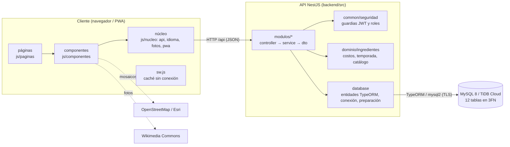

# Arquitectura de SIGEPA

SIGEPA es un **monolito modular en capas**: un solo servicio (NestJS) sirve la API REST y el front.
Se eligió así porque el equipo es pequeño, se despliega en un solo servicio gratuito (Render) y cada módulo
se puede separar después si el sistema crece.

## Capas del backend

| Carpeta | Responsabilidad | Regla |
|---|---|---|
| `config/` | Lee variables de entorno (`.env` o Render) | Es el único lugar que toca `process.env` |
| `database/` | Entidades (una por tabla), conexión, creación automática de tablas | Las entidades reflejan `database/esquema.sql` ([BASE_DE_DATOS.md](BASE_DE_DATOS.md)) |
| `common/` | Seguridad (sesión JWT, guardias por rol) y utilidades | Sin lógica de negocio |
| `dominio/` | Lógica pura: precios, costo de recetas, temporadas | No conoce Nest ni la base; se prueba con `npm test` |
| `modulos/` | Un módulo por caso de uso: `controller` (HTTP), `service` (reglas), `dto` (validación) | Los controladores no hacen consultas |

### Módulos

| Módulo | Ruta | Qué hace |
|---|---|---|
| auth | `/api/auth` | Registro, inicio de sesión, sesión actual |
| usuarios | `/api/usuarios` | Perfil, recetas propias, pasar a portador |
| favoritos | `/api/usuarios/yo/favoritos` | Recetas guardadas (tabla asociativa `favorito`) |
| recetas | `/api/recetas` | Búsqueda, mapa, detalle, costo, publicar, validar |
| comentarios | `/api/recetas/:id/comentarios`, `/api/comentarios` | Comentar y moderar |
| estados | `/api/estados` | Catálogo de los 32 estados |
| archivos | `/api/uploads` | Fotos subidas por portadores |
| asistente | `/api/asistente` | Chat de presupuesto, recolección y búsqueda |
| temporadas | `/api/temporadas` | Ingredientes en temporada por mes y estado |
| datos-abiertos | `/api/datos-abiertos` | Recetas validadas en GeoJSON y CSV |
| salud | `/api/salud` | Revisión de que la API y la base responden |

### Roles (`usuario.tipoUsu` → catálogo `tipo_usuario`)

| Valor | Rol | Guardia |
|---|---|---|
| 1 | Moderador | `ModeradorGuard` |
| 2 | Usuario | `SesionGuard` |
| 3 | Portador(a) de saberes | `PortadorGuard` |

## Front

HTML, CSS y JavaScript con módulos ES, sin frameworks ni paso de compilación:

- `js/nucleo/` — servicios compartidos: cliente de la API, traducciones (español, maya, náhuatl), fotos, PWA.
- `js/componentes/` — piezas reutilizables: encabezado y pie, tarjetas, mapa, asistente, modo cocina, dictado.
- `js/paginas/` — un archivo por pantalla HTML.

La política de seguridad (CSP) solo permite scripts propios, por eso ninguna página tiene `<script>` en línea.

## Seguridad

- Contraseñas con bcrypt; sesiones con JWT.
- Validación de toda entrada con `class-validator` (se descartan campos desconocidos).
- `helmet` (CSP, HSTS en producción), límite de peticiones (300/min general, 10/min en login y registro).
- Conexión a la base con TLS verificado en la nube.

## Despliegue

Render (servicio web gratuito) + TiDB Cloud Starter (MySQL compatible, gratis). Ver [DESPLIEGUE.md](DESPLIEGUE.md).
Cada push pasa por GitHub Actions (`.github/workflows/ci.yml`): pruebas, compilación y un arranque real contra MySQL 8.

## Acceso a datos

- Una receta se lee con sus relaciones muchos a uno en una consulta (municipio, estado, región, lengua, autor) y sus
  ingredientes y pasos en dos consultas más para toda la página de resultados, sin importar cuántas recetas sean.
- Publicar o editar una receta es una **transacción**: receta, ingredientes y pasos se guardan juntos o no se guarda
  nada.
- La búsqueda por ingrediente usa `EXISTS` sobre `receta_ingrediente` con el índice `ix_ri_ingrediente`.
- El conteo de recetas por estado del mapa sale de la vista `v_recetas_por_estado`.
