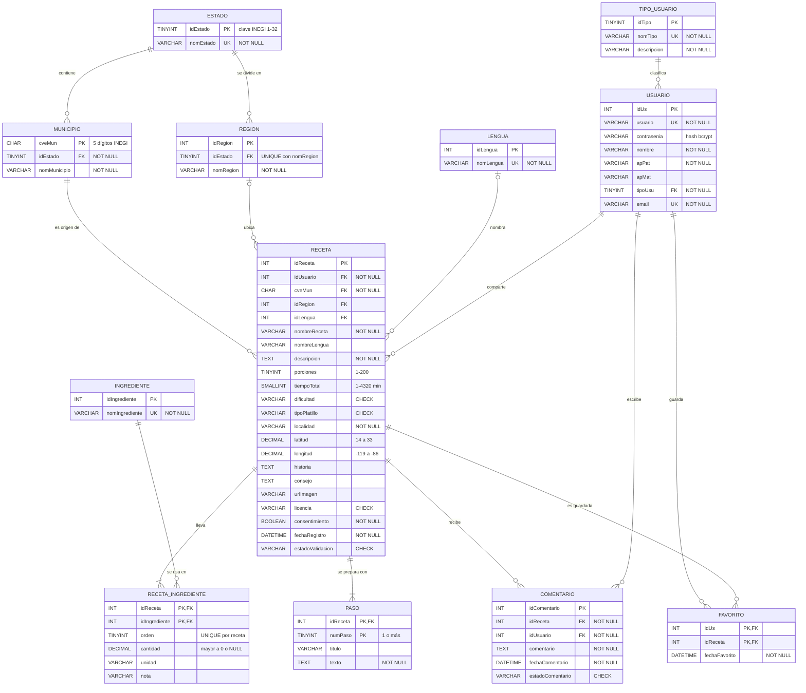

# Base de datos de SIGEPA

Modelo relacional normalizado a **tercera forma normal (3FN)**, implementado en MySQL 8 (compatible con MariaDB 10.4+
y TiDB Cloud). El script está en [`database/esquema.sql`](../database/esquema.sql) y los datos en
[`database/datos.sql`](../database/datos.sql).

| Tipo | Tablas |
|---|---|
| Catálogos | `tipo_usuario`, `estado`, `municipio`, `region`, `lengua`, `ingrediente` |
| Entidades principales | `usuario`, `receta` |
| Dependientes | `paso` (composición 1:N de receta), `comentario` |
| Asociativas (M:N) | `receta_ingrediente`, `favorito` |
| Vistas | `v_recetas_por_estado`, `v_receta_ficha` |

Datos de ejemplo: 3 roles, 32 estados, 2,475 municipios (INEGI), 48 regiones, 15 lenguas, 196 ingredientes,
21 cuentas, 68 recetas con 327 ingredientes y 208 pasos, 4 comentarios y 6 favoritos.

---

## 1. Identificación de entidades, atributos y relaciones

| Entidad | Descripción | Llave primaria | Llaves foráneas | Relaciones y cardinalidad |
|---|---|---|---|---|
| tipo_usuario | Catálogo de roles del sistema. | idTipo | — | tipo_usuario 1:N usuario |
| estado | Entidades federativas (clave INEGI). | idEstado | — | estado 1:N municipio; estado 1:N region |
| municipio | Municipios del Marco Geoestadístico del INEGI. | cveMun | idEstado | municipio 1:N receta |
| region | Regiones culturales de cada estado. | idRegion | idEstado | region 1:N receta (opcional) |
| lengua | Lenguas originarias en que se nombra un platillo. | idLengua | — | lengua 1:N receta (opcional) |
| ingrediente | Catálogo de ingredientes. | idIngrediente | — | ingrediente 1:N receta_ingrediente |
| usuario | Cuenta de moderador, usuario o portador(a) de saberes. | idUs | tipoUsu | usuario 1:N receta; 1:N comentario; 1:N favorito |
| receta | Saber culinario compartido por un portador, ubicado en su municipio. | idReceta | idUsuario, cveMun, idRegion, idLengua | receta 1:N receta_ingrediente; 1:N paso; 1:N comentario; 1:N favorito |
| receta_ingrediente | Ingrediente usado en una receta, con cantidad y unidad (resuelve receta M:N ingrediente). | (idReceta, idIngrediente) | idReceta, idIngrediente | receta 1:N; ingrediente 1:N |
| paso | Paso de preparación de una receta. | (idReceta, numPaso) | idReceta | receta 1:N paso (composición) |
| comentario | Comentario de un usuario sobre una receta, con moderación. | idComentario | idReceta, idUsuario | receta 1:N; usuario 1:N |
| favorito | Receta que un usuario guarda (resuelve usuario M:N receta). | (idUs, idReceta) | idUs, idReceta | usuario 1:N; receta 1:N |

Las dos relaciones muchos a muchos del dominio (una receta tiene muchos ingredientes y un ingrediente aparece en
muchas recetas; un usuario guarda muchas recetas y una receta la guardan muchos usuarios) se resuelven con tablas
asociativas con llave primaria compuesta. `receta_ingrediente` además lleva los atributos propios de la relación:
cantidad, unidad, orden y nota.

---

## 2. Diagrama Entidad-Relación



La imagen del diagrama para documentos está en [`docs/img/modelo-er.png`](img/modelo-er.png).

---

## 3. Diccionario de datos

Convención: tablas en minúsculas y en singular; atributos en camelCase; restricciones con prefijo
`pk_`, `fk_`, `uq_`, `ck_` e índices con `ix_`. Juego de caracteres `utf8mb4` (acentos, ñ y lenguas originarias).

### tipo_usuario

| Atributo | Tipo de dato | Restricción | Descripción |
|---|---|---|---|
| idTipo | TINYINT | PK, NOT NULL | 1 = Moderador, 2 = Usuario, 3 = Portador de saberes. |
| nomTipo | VARCHAR(30) | NOT NULL, UNIQUE | Nombre del rol. |
| descripcion | VARCHAR(150) | NOT NULL | Qué puede hacer el rol. |

### estado

| Atributo | Tipo de dato | Restricción | Descripción |
|---|---|---|---|
| idEstado | TINYINT | PK, NOT NULL, CHECK 1–32 | Clave de entidad federativa del INEGI. |
| nomEstado | VARCHAR(20) | NOT NULL, UNIQUE | Nombre del estado. |

### municipio

| Atributo | Tipo de dato | Restricción | Descripción |
|---|---|---|---|
| cveMun | CHAR(5) | PK, NOT NULL, CHECK 5 dígitos | Clave geoestadística INEGI: 2 dígitos de entidad + 3 de municipio. |
| idEstado | TINYINT | FK → estado, NOT NULL, CHECK = 2 primeros dígitos de cveMun | Estado al que pertenece. |
| nomMunicipio | VARCHAR(80) | NOT NULL | Nombre oficial del municipio. |

### region

| Atributo | Tipo de dato | Restricción | Descripción |
|---|---|---|---|
| idRegion | INT | PK, AUTO_INCREMENT | Identificador de la región. |
| idEstado | TINYINT | FK → estado, NOT NULL | Estado al que pertenece. |
| nomRegion | VARCHAR(60) | NOT NULL; UNIQUE (idEstado, nomRegion) | Nombre de la región cultural (Valles Centrales, Huasteca…). |

### lengua

| Atributo | Tipo de dato | Restricción | Descripción |
|---|---|---|---|
| idLengua | INT | PK, AUTO_INCREMENT | Identificador de la lengua. |
| nomLengua | VARCHAR(40) | NOT NULL, UNIQUE | Nombre de la lengua originaria (Náhuatl, Maya yucateco…). |

### ingrediente

| Atributo | Tipo de dato | Restricción | Descripción |
|---|---|---|---|
| idIngrediente | INT | PK, AUTO_INCREMENT | Identificador del ingrediente. |
| nomIngrediente | VARCHAR(80) | NOT NULL, UNIQUE | Nombre del ingrediente; cada nombre se registra una sola vez. |

### usuario

| Atributo | Tipo de dato | Restricción | Descripción |
|---|---|---|---|
| idUs | INT | PK, AUTO_INCREMENT | Identificador del usuario. |
| usuario | VARCHAR(40) | NOT NULL, UNIQUE | Nombre de usuario. |
| contrasenia | VARCHAR(255) | NOT NULL | Hash bcrypt de la contraseña (nunca texto plano). |
| nombre | VARCHAR(20) | NOT NULL | Nombre(s). |
| apPat | VARCHAR(20) | NOT NULL | Apellido paterno. |
| apMat | VARCHAR(20) | NULL | Apellido materno. |
| tipoUsu | TINYINT | FK → tipo_usuario, NOT NULL, DEFAULT 2 | Rol del usuario. |
| email | VARCHAR(40) | NOT NULL, UNIQUE, CHECK formato | Correo con el que inicia sesión. |

### receta

| Atributo | Tipo de dato | Restricción | Descripción |
|---|---|---|---|
| idReceta | INT | PK, AUTO_INCREMENT | Identificador de la receta. |
| idUsuario | INT | FK → usuario, NOT NULL | Portador(a) que la comparte. |
| cveMun | CHAR(5) | FK → municipio, NOT NULL | Municipio de origen (de él se obtiene el estado). |
| idRegion | INT | FK → region, NULL | Región cultural, si se indica. |
| idLengua | INT | FK → lengua, NULL | Lengua del nombre originario. |
| nombreReceta | VARCHAR(30) | NOT NULL | Nombre del platillo en español. |
| nombreLengua | VARCHAR(60) | NULL | Nombre del platillo en su lengua originaria. |
| descripcion | TEXT | NOT NULL | Presentación de la receta. |
| porciones | TINYINT UNSIGNED | NULL, CHECK 1–200 | Número de porciones. |
| tiempoTotal | SMALLINT UNSIGNED | NULL, CHECK 1–4320 | Tiempo total en minutos. |
| dificultad | VARCHAR(10) | NULL, CHECK (Fácil, Intermedia, Avanzada) | Nivel de dificultad. |
| tipoPlatillo | VARCHAR(20) | NULL, CHECK (8 tipos) | Plato fuerte, sopa o caldo, antojito, tamal, salsa o mole, guarnición, postre o bebida. |
| localidad | VARCHAR(80) | NOT NULL | Comunidad de origen (nunca un domicilio). |
| latitud | DECIMAL(8,5) | NULL, CHECK 14–33 | Coordenada del punto en el mapa. |
| longitud | DECIMAL(8,5) | NULL, CHECK −119 a −86; ambas o ninguna | Coordenada del punto en el mapa. |
| historia | TEXT | NULL | Historia detrás del platillo. |
| consejo | TEXT | NULL | Consejo de quien la comparte. |
| urlImagen | VARCHAR(255) | NULL | Foto subida (/uploads/…) o enlace https con licencia libre. |
| licencia | VARCHAR(20) | NOT NULL, CHECK, DEFAULT saber-comunitario | Uso permitido: saber-comunitario o cc-by-nc-sa. |
| consentimiento | BOOLEAN | NOT NULL, DEFAULT FALSE | La comunidad está de acuerdo en compartir el saber. |
| fechaRegistro | DATETIME | NOT NULL, DEFAULT CURRENT_TIMESTAMP | Fecha de publicación. |
| estadoValidacion | VARCHAR(20) | NOT NULL, CHECK, DEFAULT pendiente | pendiente, validada o rechazada. Solo se valida con consentimiento. |

### receta_ingrediente

| Atributo | Tipo de dato | Restricción | Descripción |
|---|---|---|---|
| idReceta | INT | PK, FK → receta (ON DELETE CASCADE) | Receta. |
| idIngrediente | INT | PK, FK → ingrediente (ON DELETE RESTRICT) | Ingrediente. |
| orden | TINYINT UNSIGNED | NOT NULL, CHECK ≥ 1; UNIQUE (idReceta, orden) | Posición en la lista. |
| cantidad | DECIMAL(8,2) | NULL, CHECK > 0 | Cantidad; NULL significa "al gusto". |
| unidad | VARCHAR(20) | NULL | g, kg, tazas, piezas… |
| nota | VARCHAR(60) | NULL | Cómo se prepara el ingrediente ("sin semillas", "en cubos"). |

### paso

| Atributo | Tipo de dato | Restricción | Descripción |
|---|---|---|---|
| idReceta | INT | PK, FK → receta (ON DELETE CASCADE) | Receta. |
| numPaso | TINYINT UNSIGNED | PK, CHECK ≥ 1 | Número del paso. |
| titulo | VARCHAR(80) | NULL | Título corto del paso. |
| texto | TEXT | NOT NULL | Instrucción. |

### comentario

| Atributo | Tipo de dato | Restricción | Descripción |
|---|---|---|---|
| idComentario | INT | PK, AUTO_INCREMENT | Identificador del comentario. |
| idReceta | INT | FK → receta (ON DELETE CASCADE), NOT NULL | Receta comentada. |
| idUsuario | INT | FK → usuario (ON DELETE RESTRICT), NOT NULL | Autor del comentario. |
| comentario | TEXT | NOT NULL | Texto del comentario. |
| fechaComentario | DATETIME | NOT NULL, DEFAULT CURRENT_TIMESTAMP | Fecha. |
| estadoComentario | VARCHAR(20) | NOT NULL, CHECK, DEFAULT publicado | publicado, oculto o eliminado (moderación). |

### favorito

| Atributo | Tipo de dato | Restricción | Descripción |
|---|---|---|---|
| idUs | INT | PK, FK → usuario (ON DELETE CASCADE) | Usuario que guarda. |
| idReceta | INT | PK, FK → receta (ON DELETE CASCADE) | Receta guardada. |
| fechaFavorito | DATETIME | NOT NULL, DEFAULT CURRENT_TIMESTAMP | Cuándo la guardó. |

---

## 4. Normalización

**Primera forma normal (1FN): valores atómicos, sin grupos repetidos.**
La lista de ingredientes y la lista de pasos ya no se guardan como texto dentro de la receta: cada ingrediente es
una fila de `receta_ingrediente` y cada paso una fila de `paso`. Los ingredientes compuestos se separaron
("clavo y canela" → clavo, canela) y la forma de preparación pasó a su propia columna
("chiles guajillo, sin semillas" → ingrediente *chiles guajillo*, nota *sin semillas*). La cantidad es un número
(`DECIMAL`), no texto: "½" se guarda como 0.50.

**Segunda forma normal (2FN): sin dependencias parciales de una llave compuesta.**
En `receta_ingrediente` la cantidad, la unidad, el orden y la nota dependen de la receta *y* del ingrediente
juntos; el nombre del ingrediente, que depende solo de `idIngrediente`, vive en `ingrediente`. En `paso` el texto
depende de (idReceta, numPaso), y en `favorito` la fecha depende del par (idUs, idReceta).

**Tercera forma normal (3FN): sin dependencias transitivas.**
- La receta guarda su municipio y **no** su estado: `idReceta → cveMun → idEstado`. Guardar los dos permitiría una
  receta "en Mitla, Yucatán". El estado se obtiene con un JOIN (o con la vista `v_receta_ficha`).
- El nombre del rol no se repite en cada usuario: `usuario.tipoUsu` apunta a `tipo_usuario`.
- Los nombres de municipio, región, lengua e ingrediente se escriben una vez en su catálogo y las recetas los
  referencian por llave.

---

## 5. Integridad referencial

| Llave foránea | Al borrar el padre | Motivo |
|---|---|---|
| receta → usuario | RESTRICT | No se pierde el saber de una comunidad al borrar una cuenta. |
| receta → municipio | RESTRICT | El catálogo INEGI no se borra si tiene recetas. |
| receta → region, lengua | SET NULL | Son datos opcionales de la receta. |
| receta_ingrediente, paso → receta | CASCADE | No existen sin su receta (composición). |
| receta_ingrediente → ingrediente | RESTRICT | No se borra un ingrediente que usan recetas. |
| comentario → receta | CASCADE | Al borrar la receta se van sus comentarios. |
| comentario → usuario | RESTRICT | Conserva el historial de moderación. |
| favorito → usuario, receta | CASCADE | Un favorito no tiene sentido sin alguna de las dos partes. |
| municipio, region → estado | RESTRICT (también al actualizar) | Las claves INEGI no cambian. |
| usuario → tipo_usuario | RESTRICT | No se borra un rol en uso. |

## 6. Reglas de negocio

En la base (CHECK, UNIQUE y llaves foráneas):

- Los dos primeros dígitos de `municipio.cveMun` son su `idEstado`.
- Latitud y longitud van juntas y dentro del territorio nacional.
- Porciones de 1 a 200, tiempo de 1 a 4,320 minutos, cantidades mayores a cero.
- Dificultad, tipo de platillo, licencia, estado de validación y estado de comentario solo aceptan sus valores.
- Una receta **solo puede estar validada si tiene consentimiento** (`ck_receta_consentimiento`).
- Un ingrediente no se repite en la misma receta (PK compuesta) y cada posición de la lista es única.
- Un usuario no guarda dos veces la misma receta (PK compuesta de `favorito`).

En la API (`backend/src/modulos/recetas/recetas.service.ts`), porque dependen de varias tablas:

- La región elegida debe ser del mismo estado que el municipio.
- El municipio debe pertenecer al estado que eligió la persona.
- Receta, ingredientes y pasos se guardan en **una transacción**: o se guarda todo o nada.
- Si una región, lengua o ingrediente nuevo no existe en su catálogo, se agrega (el catálogo crece con la comunidad
  y el moderador lo revisa al validar la receta).

> TiDB Cloud solo aplica los CHECK con `tidb_enable_check_constraint = ON`; la API intenta activarla antes de crear las
> tablas y, por si el servicio no lo permite, también valida esas reglas (`receta.dto.ts`). MySQL 8 y MariaDB los
> aplican siempre.

## 7. Índices y vistas

| Índice | Para qué |
|---|---|
| ix_receta_validacion (estadoValidacion, fechaRegistro) | Listado público ordenado por fecha. |
| ix_receta_municipio, ix_municipio_estado | Filtro por estado y municipio en el mapa. |
| ix_ri_ingrediente | Búsqueda de recetas por ingrediente. |
| ix_receta_usuario, ix_comentario_receta, ix_favorito_receta | Perfil, comentarios y favoritos. |

- `v_recetas_por_estado`: número de recetas validadas por estado (la usa `GET /api/estados` para el mapa).
- `v_receta_ficha`: cada receta con estado, municipio, región, lengua, autor y totales de ingredientes, pasos y
  favoritos (para reportes y consultas del moderador).

Ejemplo de consulta:

```sql
-- Recetas de Oaxaca que llevan hierba santa
SELECT f.nombreReceta, f.nomMunicipio, f.autor
FROM v_receta_ficha f
WHERE f.idEstado = 20 AND f.estadoValidacion = 'validada'
  AND EXISTS (SELECT 1 FROM receta_ingrediente ri JOIN ingrediente i USING (idIngrediente)
              WHERE ri.idReceta = f.idReceta AND i.nomIngrediente LIKE '%hierba santa%');
```

---

## 8. Cambios respecto al diccionario de datos original (10.2)

| No. | Elemento | Antes | Ahora | Razón |
|---|---|---|---|---|
| 1 | receta.ingredientes | TEXT con la lista completa | Tablas `ingrediente` y `receta_ingrediente` | 1FN: un valor por campo; permite buscar por ingrediente con SQL. |
| 2 | receta.preparacion | TEXT con pasos y datos de la receta | Tabla `paso` y columnas propias en `receta` | 1FN; cada dato con su tipo y su CHECK. |
| 3 | receta.idEstado | FK a estado | Se reemplaza por `cveMun` (FK a municipio) | 3FN: el estado depende del municipio. |
| 4 | Municipio | Texto dentro de la receta | Catálogo `municipio` con los 2,475 del INEGI | Integridad: solo municipios reales. |
| 5 | Región y lengua | Texto libre | Catálogos `region` y `lengua` | Evita variantes del mismo nombre. |
| 6 | usuario.tipoUsu | INT con valores 1, 2, 3 | FK al catálogo `tipo_usuario` | El diccionario pedía "definir catálogo de roles". |
| 7 | Favoritos | Solo en el navegador | Tabla asociativa `favorito` | Se conservan entre dispositivos. |
| 8 | Licencia y consentimiento | No existían | Columnas en `receta` con CHECK | Respeto al saber comunitario. |
| 9 | Restricciones | PK y FK | Además CHECK, UNIQUE compuestos, índices y vistas | Reglas de negocio en la base. |
